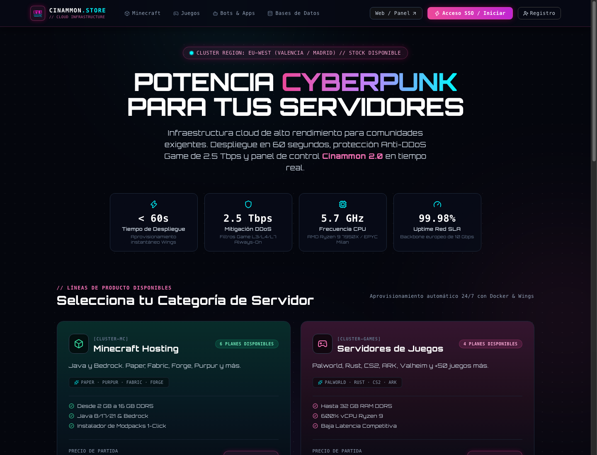
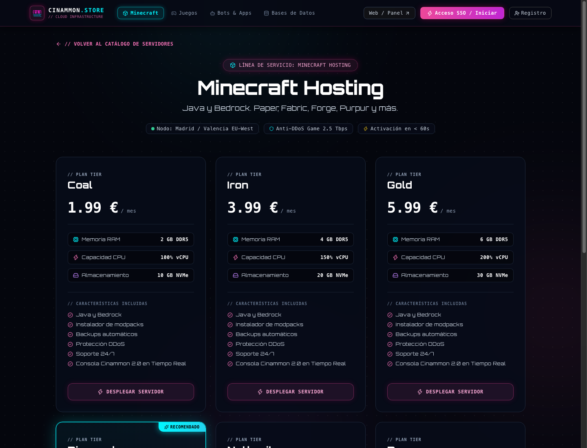
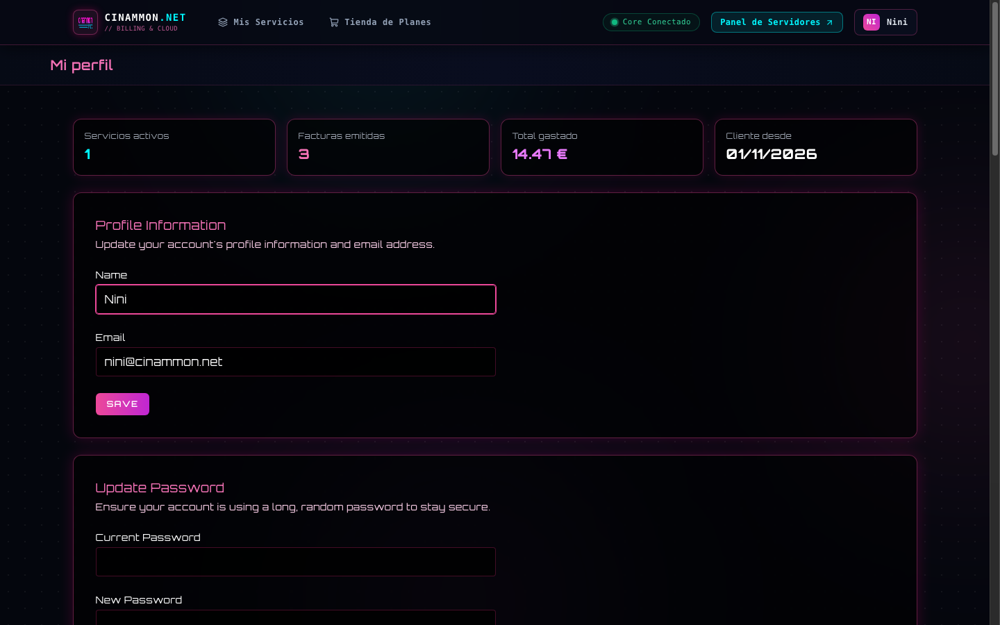
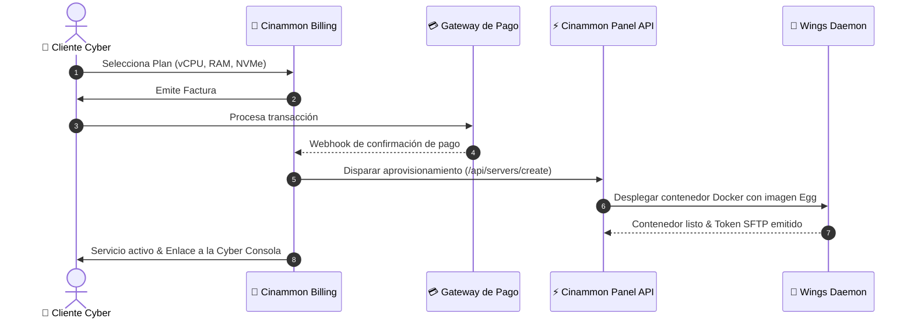

<p align="center">
  <pre align="center">
<font color="#ff007f"><b>╔═╗╦╔╗╔╔═╗╔╦╗╔╦╗╔═╗╔╗╔  ╔╗ ╦╦  ╦  ╦╔╗╔╔═╗</b></font>
<font color="#a855f7"><b>║  ║║║║╠═╣║║║║║║║ ║║║║  ╠╩╗║║  ║  ║║║║║ ╦</b></font>
<font color="#00f7ff"><b>╚═╝╩╝╚╝╩ ╩╩ ╩╩ ╩╚═╝╝╚╝  ╚═╝╩╩═╝╩═╝╩╝╚╝╚═╝</b></font>
  </pre>
  <p align="center">
    <b><code>// SYNTHWAVE CLIENT PORTAL & AUTOMATED REVENUE REPUTATION ENGINE //</code></b>
  </p>
  <p align="center">
    <a href="https://github.com/cinammon-net/billing"></a>
    <a href="https://github.com/cinammon-net/billing"></a>
    <a href="https://github.com/cinammon-net/billing"></a>
    <a href="https://github.com/cinammon-net/panel"></a>
  </p>
</p>

---

## ⚡ // 01. VISUAL INTERFACE & CLIENT PORTAL

<div align="center">
  <p><b>💳 CLIENT BILLING DASHBOARD & ACTIVE SUBSCRIPTIONS</b></p>
  
  <p><i>Interfaz reactiva de usuario: administración de pedidos en tiempo real, desglose de facturas y accesos directos al panel.</i></p>
</div>

<br />

<div align="center">
  <table width="100%">
    <tr>
      <td width="50%" align="center">
        <b>🛒 PLANS & HARDWARE MATRIX</b><br /><br />
        <br />
        <sub>Catálogo categorizado por juegos, bases de datos y bots con aprovisionamiento instantáneo.</sub>
      </td>
      <td width="50%" align="center">
        <b>⛏️ MINECRAFT & GAME TIERS</b><br /><br />
        <br />
        <sub>Planes con asignación garantizada de RAM DDR5, Ryzen 9 vCPU y almacenamiento NVMe Gen4.</sub>
      </td>
    </tr>
    <tr>
      <td width="50%" align="center">
        <br /><b>🔐 CYBER IDENTITY & 2FA FORTIFY</b><br /><br />
        <br />
        <sub>Seguridad de doble factor (TOTP), control de sesiones activas y facturación cifrada.</sub>
      </td>
      <td width="50%" align="center">
        <br /><b>🔑 SEAMLESS SSO AUTHENTICATION</b><br /><br />
        <br />
        <sub>Traspaso de sesión firmado criptográficamente por HMAC SHA-256 desde el panel a facturación.</sub>
      </td>
    </tr>
  </table>
</div>

---

## 🛰️ // 02. ARCHITECTURE & DISPATCH PIPELINE



---

## 🔮 // 03. CORE MODULES

* **💎 Automated Storefront (`/store`)**: Tienda pública reactiva organizada por categorías de servidores (Minecraft, Bots, Juegos dedicados, Bases de datos) con badges de hardware Ryzen 9 y DDR5.
* **🌐 API de Catálogo (`/api/plans`)**: Endpoint JSON de alta velocidad consumido por la landing principal de Cinammon para reflejar precios y cuotas de hardware al instante.
* **🧾 Lifecycle de Facturación & Cancelación Asistida**: Estados automatizados (`active`, `pending`, `suspended`, `cancelled`, `paid`, `overdue`). Al cancelar un servicio, el daemon Wings **detiene inmediatamente** el contenedor Docker y se activa un periodo de gracia de 7 días antes de la purga permanente.
* **🔑 Seamless Single Sign-On (SSO)**: Acceso directo sin re-login. Al navegar desde el Panel a `/billing/redirect`, se emite un payload firmado criptográficamente con HMAC-SHA256 (`PANEL_API_TOKEN`) que autentica al usuario en el portal de facturación en milisegundos.
* **🔐 Ciberseguridad & 2FA**: Integración nativa con autenticación de dos factores (TOTP RFC 6238), códigos de recuperación y desconexión remota de sesiones concurrentes.
* **🌉 Seamless Panel Bridge**: Sincronización bidireccional transparente con [Cinammon Panel](https://github.com/cinammon-net/panel). El usuario adquiere el servicio y pasa directamente a administrar sus archivos y consola.

---

## 🛠️ // 04. QUICKSTART & DEPLOYMENT

### Variables de Entorno Clave (`.env`)

```env
APP_NAME="Cinammon Billing"
APP_ENV=production
APP_KEY=base64:...
APP_URL=https://billing.cinammon.net

# Conexión con el núcleo del Panel
PANEL_URL=https://panel.cinammon.net
PANEL_API_KEY=cinammon_secret_dispatch_token

# Base de datos
DB_CONNECTION=mysql
DB_HOST=127.0.0.1
DB_PORT=3306
DB_DATABASE=cinammon_billing
DB_USERNAME=cinammon
DB_PASSWORD=secret_cyber_pass
```

### Comandos de Instalación

```bash
# 1. Instalar dependencias
composer install --no-dev --optimize-autoloader
npm ci

# 2. Generar clave y migrar esquema
php artisan key:generate
php artisan migrate --force

# 3. Compilar bundles frontend de producción
npm run build

# 4. Optimizar cachés
php artisan config:cache
php artisan route:cache
php artisan view:cache
```

---

## 📡 // 05. ECOSYSTEM MATRIX

| Repositorio | Función | Stack Tecnológico |
| :--- | :--- | :--- |
| **[cinammon-net/billing](https://github.com/cinammon-net/billing)** | Portal de clientes, tienda de planes automatizada y pasarelas | Laravel 11, Inertia.js, TailwindCSS, Fortify 2FA |
| **[cinammon-net/panel](https://github.com/cinammon-net/panel)** | Orquestador principal, interfaz de administración y consola cyber | Laravel 11, React 18, Inertia.js, TailwindCSS |
| **[cinammon-net/wings](https://github.com/cinammon-net/wings)** | Daemon de alto rendimiento, comunicación WebSocket y SFTP | Golang 1.23, Docker Engine API, WebSockets |
| **[cinammon-net/eggs](https://github.com/cinammon-net/eggs)** | Catálogo de más de 129 plantillas de instalación y ejecución | Dockerfiles, Bash Scripts, JSON Blueprints |

---

<p align="center">
  <sub>Cinammon.net // Synthwave Financial Architecture // 2026</sub>
</p>
